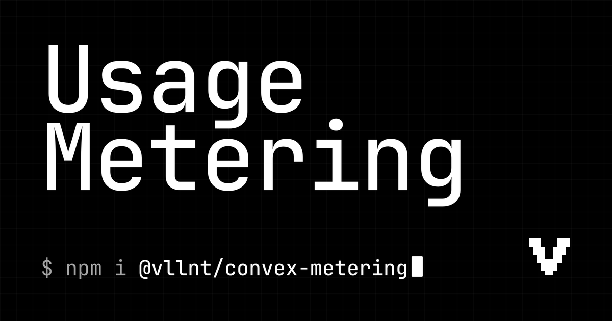

# @vllnt/convex-metering

Usage metering as a Convex component: idempotent usage events rolled up per billing period, with atomic limits, period close and signed corrections.



## For coding agents

Docs for the installed version ship in `node_modules/@vllnt/convex-metering/`: `README.md`,
`docs/API.md`, `llms.txt`, `CHANGELOG.md` and the TypeScript `src/`. They match the installed
version. Read them before writing code against this package.

## When to use

- Use it when you bill or report usage per subject and period (requests, bytes, seats) and a
  retried event must not be counted twice.
- Use it when a usage cap must be checked and recorded in one transaction (`recordWithLimit`).
- Use it when a billed period must be frozen and corrections must leave an audit trail
  (`closePeriod`, `adjust`, `verify`).
- Do not use it when an allowance resets on a schedule and you read what remains: use
  [`@vllnt/convex-quota`](https://oss.vllnt.com/packages/convex-quota).
- Do not use it when users spend a prepaid balance: use
  [`@vllnt/convex-wallet`](https://oss.vllnt.com/packages/convex-wallet).
- Do not use it when you need to throttle requests per time window: use a rate limiter such as
  `@convex-dev/rate-limiter`.

## Install

```bash
pnpm add @vllnt/convex-metering
```

## Quick start

```ts
// convex/convex.config.ts
import metering from "@vllnt/convex-metering/convex.config";
import { defineApp } from "convex/server";

const app = defineApp();
app.use(metering);
export default app;
```

```ts
// convex/usage.ts
import { Metering } from "@vllnt/convex-metering";
import { ConvexError, v } from "convex/values";

import { components } from "./_generated/api.js";
import { internalMutation, mutation, query } from "./_generated/server.js";

const metering = new Metering(components.metering);

export const setup = internalMutation({
  args: {},
  returns: v.boolean(),
  handler: async (ctx) => {
    const { created } = await metering.defineMeter(ctx, "api_calls", {
      aggregation: "sum",
      unit: "requests",
    });
    return created;
  },
});

export const trackApiCall = mutation({
  args: {},
  returns: v.number(),
  handler: async (ctx) => {
    const user = await ctx.auth.getUserIdentity();
    if (user === null) throw new ConvexError("not signed in");
    const period = new Date().toISOString().slice(0, 7); // UTC month, e.g. "2026-11"
    const result = await metering.record(ctx, "api_calls", user.tokenIdentifier, 1, {
      period,
    });
    return result.recorded ? result.value : 0;
  },
});

export const myUsage = query({
  args: { period: v.string() },
  returns: v.union(
    v.null(),
    v.object({ value: v.number(), count: v.number(), closed: v.boolean() }),
  ),
  handler: async (ctx, { period }) => {
    const user = await ctx.auth.getUserIdentity();
    if (user === null) throw new ConvexError("not signed in");
    return metering.usage(ctx, "api_calls", user.tokenIdentifier, { period });
  },
});
```

Run `npx convex dev` once to generate `components.metering`, then
`npx convex run usage:setup` once. Each `trackApiCall` adds 1 to the caller's
`api_calls` rollup for the current UTC month and returns the new total.
`myUsage` returns `{ value, count, closed }`, or `null` before the first call.
The component never reads auth: the host derives `subjectRef` (here the user's
`tokenIdentifier`) and `period`, and prices the usage in its own tables.

## API

Full reference: [docs/API.md](docs/API.md).

| Export | Import from | What it does |
| --- | --- | --- |
| [`Metering`](docs/API.md#metering) | `@vllnt/convex-metering` | Host client: `new Metering(components.metering, { defaultScope, defaultPeriod })` |
| [`defineMeter(ctx, key, opts?)`](docs/API.md#definemeter) | `Metering` method, mutation | Create or update a meter; returns `{ created }` |
| [`record(ctx, meter, subjectRef, quantity, opts?)`](docs/API.md#record) | `Metering` method, mutation | Record usage; returns the new rollup or `duplicate` |
| [`recordWithLimit(ctx, meter, subjectRef, quantity, limit, opts?)`](docs/API.md#recordwithlimit) | `Metering` method, mutation | Record only if the rollup stays `<= limit`; else `limit_exceeded` |
| [`adjust(ctx, meter, subjectRef, delta, opts?)`](docs/API.md#adjust) | `Metering` method, mutation | Signed correction on a `sum` meter; never below zero |
| [`closePeriod(ctx, meter, subjectRef, opts?)`](docs/API.md#closeperiod) | `Metering` method, mutation | Freeze a period; returns `false` when it has no usage |
| [`reset(ctx, meter, subjectRef, opts?)`](docs/API.md#reset) | `Metering` method, mutation | Delete one period's records and rollup in batches; returns this pass's record count |
| [`eraseSubject(ctx, subjectRef, opts?)`](docs/API.md#erasesubject) | `Metering` method, mutation | Delete a subject's records and rollups in one scope; returns this pass's row count |
| [`pruneRecords(ctx, before, batch?)`](docs/API.md#prunerecords) | `Metering` method, mutation | Delete raw records older than `before` (all scopes) |
| [`pruneSeen(ctx, before, batch?)`](docs/API.md#pruneseen) | `Metering` method, mutation | Delete idempotency keys older than `before` (all scopes) |
| [`getMeter(ctx, key, scope?)`](docs/API.md#getmeter) | `Metering` method, query | The meter definition, or `null` |
| [`listMeters(ctx, scope?)`](docs/API.md#listmeters) | `Metering` method, query | Every meter in one scope |
| [`usage(ctx, meter, subjectRef, opts?)`](docs/API.md#usage) | `Metering` method, query | `{ value, count, closed }` for one period, or `null` |
| [`listUsage(ctx, meter, subjectRef, scope?)`](docs/API.md#listusage) | `Metering` method, query | Every period of one meter for a subject |
| [`listSubjectUsage(ctx, subjectRef, scope?)`](docs/API.md#listsubjectusage) | `Metering` method, query | Every meter and period for a subject |
| [`verify(ctx, meter, subjectRef, opts?)`](docs/API.md#verify) | `Metering` method, query | Recompute a rollup from surviving records and compare |
| [`MeteringComponent`](docs/API.md#meteringcomponent) | `@vllnt/convex-metering` (type) | Type of `components.metering` |
| [`MeteringOptions`](docs/API.md#meteringoptions) | `@vllnt/convex-metering` (type) | `{ defaultScope?, defaultPeriod? }` |
| [`DefineMeterOptions`](docs/API.md#definemeteroptions) | `@vllnt/convex-metering` (type) | `{ aggregation?, unit?, scope? }` for `defineMeter` |
| [`RecordOptions`](docs/API.md#recordoptions) | `@vllnt/convex-metering` (type) | `{ period?, idempotencyKey?, actorRef?, scope? }` |
| [`RecordOutcome`](docs/API.md#recordoutcome) | `@vllnt/convex-metering` (type) | Result of `record` and `adjust` |
| [`LimitOutcome`](docs/API.md#limitoutcome) | `@vllnt/convex-metering` (type) | Result of `recordWithLimit` |
| [`MeterDefinition`](docs/API.md#meterdefinition) | `@vllnt/convex-metering` (type) | Result of `getMeter` and `listMeters` |
| [`Usage`](docs/API.md#usage-type) | `@vllnt/convex-metering` (type) | Result of `usage` |
| [`UsageEntry`](docs/API.md#usageentry) | `@vllnt/convex-metering` (type) | One row of `listUsage` |
| [`SubjectUsageEntry`](docs/API.md#subjectusageentry) | `@vllnt/convex-metering` (type) | One row of `listSubjectUsage` |
| [`VerifyResult`](docs/API.md#verifyresult) | `@vllnt/convex-metering` (type) | Result of `verify` |
| [`Aggregation`](docs/API.md#aggregation) | `@vllnt/convex-metering` (type) | `"sum" \| "max" \| "last"` |
| [`useUsage`](docs/API.md#useusage) | `@vllnt/convex-metering/react` | React hook over your `usage` wrapper; derives `remaining`, `fraction`, `exceeded` |
| [`useUsageList`](docs/API.md#useusagelist) | `@vllnt/convex-metering/react` | React hook over your `listUsage` wrapper; `UsageEntry[] \| undefined` |
| [`UsageView`](docs/API.md#usageview) | `@vllnt/convex-metering/react` (type) | Result of `useUsage` |
| [`default` (component config)](docs/API.md#convexconfig) | `@vllnt/convex-metering/convex.config` | Pass to `app.use(...)` |
| [`register`](docs/API.md#register) | `@vllnt/convex-metering/test` | Mount the component in a `convex-test` instance |
| [`ComponentApi`](docs/API.md#componentapi) | `@vllnt/convex-metering/_generated/component` | Generated type of the mounted component |

## Common tasks

Define meters once, enforce a monthly cap, record events that a queue or webhook
may deliver more than once, refund, close a month and list its invoice lines.
`seats` uses `max`, so its rollup is the peak value recorded in the period:

```ts
// convex/billing.ts
import { Metering } from "@vllnt/convex-metering";
import { ConvexError, v } from "convex/values";

import { components } from "./_generated/api.js";
import { internalMutation, internalQuery, mutation } from "./_generated/server.js";

const metering = new Metering(components.metering);

export const setupMeters = internalMutation({
  args: {},
  returns: v.null(),
  handler: async (ctx) => {
    await metering.defineMeter(ctx, "api_calls", { aggregation: "sum", unit: "requests" });
    await metering.defineMeter(ctx, "egress_bytes", { aggregation: "sum", unit: "bytes" });
    await metering.defineMeter(ctx, "seats", { aggregation: "max", unit: "seats" });
    return null;
  },
});

export const callApi = mutation({
  args: {},
  returns: v.number(),
  handler: async (ctx) => {
    const user = await ctx.auth.getUserIdentity();
    if (user === null) throw new ConvexError("not signed in");
    const period = new Date().toISOString().slice(0, 7);
    const result = await metering.recordWithLimit(
      ctx,
      "api_calls",
      user.tokenIdentifier,
      1,
      10_000,
      { period },
    );
    if (!result.recorded) throw new ConvexError("monthly API call limit reached");
    return result.value;
  },
});

export const ingestEgress = internalMutation({
  args: { subjectRef: v.string(), eventId: v.string(), bytes: v.number(), period: v.string() },
  returns: v.boolean(),
  handler: async (ctx, args) => {
    const result = await metering.record(ctx, "egress_bytes", args.subjectRef, args.bytes, {
      period: args.period,
      idempotencyKey: `egress:${args.eventId}`,
    });
    return result.recorded;
  },
});

export const refundCalls = internalMutation({
  args: { subjectRef: v.string(), period: v.string(), calls: v.number(), refundId: v.string() },
  returns: v.boolean(),
  handler: async (ctx, args) => {
    const result = await metering.adjust(ctx, "api_calls", args.subjectRef, -args.calls, {
      period: args.period,
      idempotencyKey: `refund:${args.refundId}`,
    });
    return result.recorded;
  },
});

export const closeMonth = internalMutation({
  args: { subjectRef: v.string(), period: v.string() },
  returns: v.number(),
  handler: async (ctx, { subjectRef, period }) => {
    let closed = 0;
    for (const meter of await metering.listMeters(ctx)) {
      if (await metering.closePeriod(ctx, meter.key, subjectRef, { period })) closed++;
    }
    return closed;
  },
});

export const invoiceLines = internalQuery({
  args: { subjectRef: v.string(), period: v.string() },
  returns: v.array(v.object({ meter: v.string(), value: v.number(), closed: v.boolean() })),
  handler: async (ctx, { subjectRef, period }) => {
    const rows = await metering.listSubjectUsage(ctx, subjectRef);
    return rows
      .filter((row) => row.period === period)
      .map(({ meter, value, closed }) => ({ meter, value, closed }));
  },
});
```

`ingestEgress` returns `false` for a redelivered `eventId`. Idempotency keys
are scoped to `(scope, meter)`, not to subject or period, so a key must be
unique across every subject and period of its meter. Prefix keys by source
(`egress:`, `refund:`) so that two sources writing keys to the same meter cannot
collide. Post refunds before `closeMonth`: `adjust` into a closed period throws
`PERIOD_CLOSED`.

Prune old audit rows, erase a user, and check a rollup against its records:

```ts
// convex/maintenance.ts
import { Metering } from "@vllnt/convex-metering";
import { v } from "convex/values";

import { components } from "./_generated/api.js";
import { internalMutation, internalQuery } from "./_generated/server.js";

const metering = new Metering(components.metering);
const DAY = 24 * 60 * 60 * 1000;

export const prune = internalMutation({
  args: {},
  returns: v.null(),
  handler: async (ctx) => {
    await metering.pruneRecords(ctx, Date.now() - 400 * DAY);
    await metering.pruneSeen(ctx, Date.now() - 30 * DAY);
    return null;
  },
});

export const eraseUser = internalMutation({
  args: { subjectRef: v.string() },
  returns: v.number(),
  handler: (ctx, { subjectRef }) => metering.eraseSubject(ctx, subjectRef),
});

export const audit = internalQuery({
  args: { meter: v.string(), subjectRef: v.string(), period: v.string() },
  returns: v.boolean(),
  handler: async (ctx, { meter, subjectRef, period }) => {
    const result = await metering.verify(ctx, meter, subjectRef, { period });
    return result.consistent;
  },
});
```

Call `prune` from a cron. Rollups are never pruned. `verify` re-folds only the
records that survive, so once `pruneRecords` removes part of a period it can
report `consistent: false`; audit before you prune. Keep `pruneSeen`'s cutoff older
than your longest retry window: a pruned key no longer dedupes.

Show a live usage bar in React. The hooks take a public query reference that
your app exports; its args must include `meter`, `subjectRef` and `period`:

```ts
// convex/meters.ts
import { Metering } from "@vllnt/convex-metering";
import { ConvexError, v } from "convex/values";

import { components } from "./_generated/api.js";
import { query } from "./_generated/server.js";

const metering = new Metering(components.metering);

export const usageFor = query({
  args: { meter: v.string(), subjectRef: v.string(), period: v.string() },
  returns: v.union(
    v.null(),
    v.object({ value: v.number(), count: v.number(), closed: v.boolean() }),
  ),
  handler: async (ctx, { meter, subjectRef, period }) => {
    const user = await ctx.auth.getUserIdentity();
    if (user?.tokenIdentifier !== subjectRef) throw new ConvexError("not allowed");
    return metering.usage(ctx, meter, subjectRef, { period });
  },
});
```

```tsx
// src/UsageBar.tsx
import { useUsage } from "@vllnt/convex-metering/react";

import { api } from "../convex/_generated/api.js";

export function UsageBar({ subjectRef, period }: { subjectRef: string; period: string }) {
  const usage = useUsage(
    api.meters.usageFor,
    { meter: "api_calls", subjectRef, period },
    { limit: 10_000 },
  );
  if (usage.isLoading) return null;
  return (
    <progress max={1} value={usage.fraction ?? 0}>
      {usage.value} / {usage.limit}
    </progress>
  );
}
```

Mount the component twice. Named mounts share no tables or scheduled work;
scopes are namespaces inside one mount, not access control:

```ts
// convex/convex.config.ts
import metering from "@vllnt/convex-metering/convex.config";
import { defineApp } from "convex/server";

const app = defineApp();
app.use(metering, { name: "webMetering" });
app.use(metering, { name: "gameMetering" });
export default app;
```

```ts
// convex/clients.ts
import { Metering } from "@vllnt/convex-metering";

import { components } from "./_generated/api.js";

export const web = new Metering(components.webMetering);
export const game = new Metering(components.gameMetering, {
  defaultScope: "season_1",
  defaultPeriod: "2026-11",
});
```

## Errors and fixes

Component errors are `ConvexError`s whose `data` is `{ code, message }`. Catch
them in the host with `error instanceof ConvexError` and read `error.data.code`.

| Code | Message | Cause | Fix |
| --- | --- | --- | --- |
| `INVALID_ARGUMENT` | `<name> must not be an empty string` | `defineMeter` got an empty `scope` or `key`; `record`, `recordWithLimit` or `adjust` got an empty `scope`, `meter`, `subjectRef`, `period`, `idempotencyKey` or `actorRef` | Pass non-empty strings; omit an optional field instead of passing `""`; check that `defaultScope` and `defaultPeriod` are not `""` |
| `INVALID_ARGUMENT` | `<name> must be at most 256 characters` | `defineMeter` got a `scope`, `key` or `unit` longer than 256 UTF-16 code units; `record`, `recordWithLimit` or `adjust` got a longer `scope`, `meter`, `subjectRef`, `period`, `idempotencyKey` or `actorRef`, including a call into a row stored by an older version with a longer value | Keep identifiers at most 256 characters, or hash longer ones in the host. For `idempotencyKey`, hash only keys of new events: a retry of an event first recorded with a longer key throws `INVALID_ARGUMENT`; treat that as already counted, or wait until such retries stop, before switching to hashed keys, since a hashed key does not match the stored one and would count the event again. Move usage on an old long row to a shorter meter key or subject at a period boundary, or add both rollups together when billing or enforcing a limit for that period (`recordWithLimit`, `usage` and `closePeriod` see only one of them) |
| `INVALID_QUANTITY` | `quantity must be a non-negative finite number` | `record` or `recordWithLimit` got a negative, `NaN` or infinite `quantity` | Pass a finite number `>= 0`; post negative corrections with `adjust` |
| `INVALID_QUANTITY` | `delta must be a finite number` | `adjust` got a `NaN` or infinite `delta` | Pass a finite `delta` |
| `INVALID_LIMIT` | `limit must be a non-negative finite number` | `recordWithLimit` got a negative, `NaN` or infinite `limit` | Pass a finite number `>= 0` |
| `METER_NOT_FOUND` | `no meter "<key>" in scope "<scope>" — define it first`, or `no meter "<meter>" in scope "<scope>"` from `verify` | `record`, `recordWithLimit`, `adjust` or `verify` named a meter that does not exist in that scope | Call `defineMeter` first, in the same scope; check the client's `defaultScope` |
| `IDEMPOTENCY_NOT_SUPPORTED` | `idempotencyKey is only meaningful for sum meters, not max/last gauges` | `record` or `recordWithLimit` passed an `idempotencyKey` to a `max` or `last` meter | Omit `idempotencyKey` for `max` and `last` meters |
| `PERIOD_CLOSED` | `this period is closed; record into the next open period` | `record`, `recordWithLimit` or `adjust` targeted a period frozen by `closePeriod`, including a retry of an event already recorded there | Record into an open period; post corrections before closing |
| `QUANTITY_OVERFLOW` | `the rollup would exceed the largest finite number` | `record` or `adjust` would push a `sum` rollup to `Infinity` | Check the input for a unit or loop bug |
| `AGGREGATION_LOCKED` | `a meter's aggregation is immutable once usage exists; define a new meter key` | `defineMeter` changed `aggregation` while the meter has a rollup in that scope; omitting `aggregation` sends `"sum"` | Pass the meter's current `aggregation`, or define a new meter key |
| `ADJUST_REQUIRES_SUM` | `adjust is only defined for sum meters` | `adjust` on a `max` or `last` meter | Use `adjust` on `sum` meters only |
| `ADJUST_BELOW_ZERO` | `the adjustment would make the rollup negative` | `adjust` with a `delta` below `-value` | Read `usage` first and cap the negative `delta` at the current value |
| `INVALID_BATCH` | `batch must be an integer between 1 and 500` | `reset`, `eraseSubject`, `pruneRecords` or `pruneSeen` got a `batch` that is not an integer in 1..500 | Omit `batch` (default 200) or pass an integer in 1..500 |
| `INVALID_BEFORE` | `before must be finite` | `pruneRecords` or `pruneSeen` got a `NaN` or infinite `before` | Pass an absolute ms timestamp, for example `Date.now() - 30 * DAY` |

Arguments of the wrong type are rejected by Convex argument validation before
the component runs. Outcomes that are not errors: a repeated `idempotencyKey`
returns `{ recorded: false, reason: "duplicate" }`, and `recordWithLimit` over
the limit returns `{ recorded: false, reason: "limit_exceeded", value, limit }`.

## Limits and gotchas

- Client defaults: `defaultScope: "global"`, `defaultPeriod: "all"`. A call
  that omits `period` writes to the `"all"` bucket, which never resets; the
  component has no calendar. `period` is an opaque string the host chooses.
- `defineMeter` defaults to `aggregation: "sum"` and `unit: ""`, and an update
  writes both. Re-running it without `aggregation` turns a `max` or `last`
  meter into `sum` when it has no rollup, or throws `AGGREGATION_LOCKED`.
- `reset`, `eraseSubject`, `pruneRecords` and `pruneSeen` delete up to `batch`
  rows per pass (default 200, integer 1..500) and schedule the next pass while a
  pass is full. They return only the first pass's count.
- `listMeters`, `listUsage`, `listSubjectUsage` and `verify` are not paginated:
  they read every matching row and are subject to Convex read limits.
- Idempotency keys are scoped to `(scope, meter)`, not to subject or period:
  the same key for another subject returns `duplicate`. Keys survive `reset`,
  `eraseSubject` and `pruneRecords`; only `pruneSeen` removes them. Without a key
  every call records again.
- Never take `idempotencyKey` from an untrusted client: reusing one key makes
  every later call return `duplicate`, so that usage is not recorded.
- `PERIOD_CLOSED` is checked before the duplicate check, so retrying an event
  already recorded into a now-closed period throws instead of returning
  `duplicate`.
- `recordWithLimit` records when the projected rollup is `<= limit`. For `max`
  and `last` meters the projection is the new peak or the new value. A
  `limit_exceeded` result does not store the `idempotencyKey`.
- `adjust` (and every `record`) adds 1 to `count`. `adjust` with a positive
  `delta` on a period with no usage creates its rollup.
- These return without error and change nothing: `closePeriod` on a period
  with no usage (`false`) or an already-closed one (`true`, freeze time kept);
  `reset` and `eraseSubject` for an unknown subject (`0`); `usage`, `getMeter`
  and `listUsage` for an unknown meter (`null` or `[]`); `listSubjectUsage` for
  a subject with no usage (`[]`).
- Only `defineMeter`, `record`, `recordWithLimit` and `adjust` reject empty
  strings. The other functions treat `""` as an ordinary lookup value:
  `closePeriod`, `reset`, `eraseSubject`, `getMeter`, `listMeters`, `usage`,
  `listUsage` and `listSubjectUsage` match only rows stored with that empty
  string (0.2.0 never writes them; 0.1.0 accepted them), and `verify` throws
  `METER_NOT_FOUND` unless such a meter exists.
- `reset` and `eraseSubject` also delete closed periods. `eraseSubject` works in
  one scope and does not touch `seen` keys.
- `pruneRecords` and `pruneSeen` take no scope: they delete across every scope
  in the mount.
- `verify.consistent` compares values, not counts, and is complete only while
  the period's full record history survives. With no rollup and no records it
  returns zeros and `consistent: true`.
- `sum` accumulates IEEE-754 doubles. For exact money, record integer minor
  units (bytes, mills) and price in the host.
- Every write for one `(meter, subject, period)` updates the same rollup
  document, so concurrent writes to it serialize.
- Timestamps (`createdAt`, record and key times) come from the server clock; no
  method accepts a caller timestamp. `before` compares against them in ms.
- `defineMeter`, `record`, `recordWithLimit` and `adjust` cap every string
  argument (`scope`, `key`/`meter`, `unit`, `subjectRef`, `period`,
  `idempotencyKey`, `actorRef`) at 256 UTF-16 code units (JavaScript `.length`),
  else `INVALID_ARGUMENT`. An emoji outside the Basic Multilingual Plane counts
  as 2 and an accented letter such as `"é"` as 1. The queries and
  `closePeriod`, `reset`, `eraseSubject`, `pruneRecords` and `pruneSeen` are not
  capped, so rows an older version stored with a longer value stay readable and
  erasable; recording, adjusting or redefining (`defineMeter`) them throws.

## Compatibility

- Peer dependency `convex@^1.45.0`. This repository develops and tests against
  convex 1.51.
- `react >=18` is an optional peer dependency, needed only for
  `@vllnt/convex-metering/react` (which also imports `convex/react`).
- Node.js `>=20` (`engines.node`), the minimum of `convex` 1.45; `convex` 1.51
  needs `>=22` (`npm view convex@1.51.0 engines`).
- ES modules only (`"type": "module"`); no CommonJS build ships.
- `@vllnt/convex-metering/test` ships as TypeScript source (`src/test.ts`) and
  needs `convex-test` and Vite's `import.meta.glob` (for example through
  `vitest`), with `vite/client` types.
- `convex-test` 0.0.72 and later declare peer `convex@^1.46.0`, and their types
  import `FunctionReference_future`, which convex 1.45 lacks (`tsc` reports
  TS2724 inside `convex-test` unless `skipLibCheck` is on). On convex 1.45.x,
  use `convex-test@0.0.71` or older (peer `convex@^1.43.0`).

## Testing

Mount the component in your own `convex-test` suite with `register`. Install
the test tooling as dev dependencies. `vite` is a required Vitest peer and
provides the `vite/client` types; without `@edge-runtime/vm`, Vitest throws
`Cannot find package '@edge-runtime/vm'`.

```bash
pnpm add -D convex-test vitest vite @edge-runtime/vm
```

This test uses the Quick start's `convex/usage.ts` and runs in Vitest's
`edge-runtime` environment, set in your Vitest config:

```ts
// vitest.config.ts
import { defineConfig } from "vitest/config";

export default defineConfig({
  test: {
    environment: "edge-runtime",
  },
});
```

Use the glob `./**/*.*s` (the pattern `convex-test` uses by default): it also matches the `.js` files Convex codegen
writes to `convex/_generated/`. `./**/*.ts` finds that directory only through
its `.d.ts` files; without them `convex-test` throws
`Could not find the "_generated" directory`.

The test imports your app's `convex/schema.ts`. The component's tables live in
the component, not in this schema, so any schema works; a minimal one:

```ts
// convex/schema.ts
import { defineSchema, defineTable } from "convex/server";
import { v } from "convex/values";

export default defineSchema({
  notes: defineTable({ body: v.string() }),
});
```

```ts
// convex/usage.test.ts
/// <reference types="vite/client" />
import { register } from "@vllnt/convex-metering/test";
import { convexTest } from "convex-test";
import { expect, test, vi } from "vitest";

import { api, internal } from "./_generated/api.js";
import schema from "./schema.js";

test("a signed-in user's API calls are metered per UTC month", async () => {
  vi.useFakeTimers();
  vi.setSystemTime(new Date("2026-11-15T12:00:00Z"));
  const t = convexTest(schema, import.meta.glob("./**/*.*s"));
  register(t);
  await t.mutation(internal.usage.setup, {});
  const user = t.withIdentity({ tokenIdentifier: "user-1" });
  await user.mutation(api.usage.trackApiCall, {});
  expect(await user.mutation(api.usage.trackApiCall, {})).toBe(2);
  expect(await user.query(api.usage.myUsage, { period: "2026-11" })).toEqual({
    value: 2,
    count: 2,
    closed: false,
  });
  vi.useRealTimers();
});
```

`register(t, name)` takes the mount name when you used
`app.use(metering, { name })`; the default is `"metering"`.

This repository's own tests (`pnpm test`, and `pnpm test:coverage` with 100%
coverage enforced) use the simulated `convex-test` backend, not a real Convex
deployment; they do not prove production concurrency or scheduler delivery.

## Security

- The component does not authenticate. The host must authorize every call and
  derive `subjectRef`, `scope`, `period` and `idempotencyKey` itself. A wrapper
  that passes a client-supplied `subjectRef` lets that client read or write any
  subject.
- Component functions are reachable only through the host's own functions;
  `subjectRef`, `actorRef`, `scope` and `period` are opaque strings.
- `pruneRecords` and `pruneSeen` act on every scope of a mount: expose them to
  administrators only.
- `eraseSubject` deletes a subject's records (including their `actorRef`) and
  rollups in one scope. It leaves `seen` keys, which hold no `subjectRef`; do
  not put personal data in idempotency keys.

Report vulnerabilities as described in
[SECURITY.md](https://github.com/vllnt/convex-metering/blob/main/SECURITY.md).

## Related packages

None. No other @vllnt package is used with this one in code (no dependency, shared test or example).

## Contributing

See
[CONTRIBUTING.md](https://github.com/vllnt/convex-metering/blob/main/CONTRIBUTING.md).

## Links

- Docs and changelog: [oss.vllnt.com/packages/convex-metering](https://oss.vllnt.com/packages/convex-metering) · [release feed](https://oss.vllnt.com/packages/convex-metering/rss.xml)
- All @vllnt packages: [oss.vllnt.com](https://oss.vllnt.com) · [search packages and docs on index.vllnt.com](https://index.vllnt.com)
- Source and issues: [GitHub](https://github.com/vllnt/convex-metering) · [issues](https://github.com/vllnt/convex-metering/issues) · [npm](https://www.npmjs.com/package/@vllnt/convex-metering)
- Questions and updates: [Discord](https://bntvllnt.com/discord) · [X @bntvllnt](https://x.com/bntvllnt)
- Company and author: [vllnt.com](https://vllnt.com) · [bntvllnt.com](https://bntvllnt.com) · [GitHub @bntvllnt](https://github.com/bntvllnt) · [LinkedIn](https://linkedin.com/in/bntvllnt)
- Sponsor: [GitHub Sponsors](https://github.com/sponsors/bntvllnt)

## License

MIT. See [LICENSE](LICENSE).

[](https://www.npmjs.com/package/@vllnt/convex-metering)
[](https://github.com/vllnt/convex-metering/actions/workflows/ci.yml)

---

Part of [vllnt open source](https://oss.vllnt.com) · [Package page](https://oss.vllnt.com/packages/convex-metering) · [vllnt.com](https://vllnt.com) · Built by [bntvllnt](https://bntvllnt.com)
